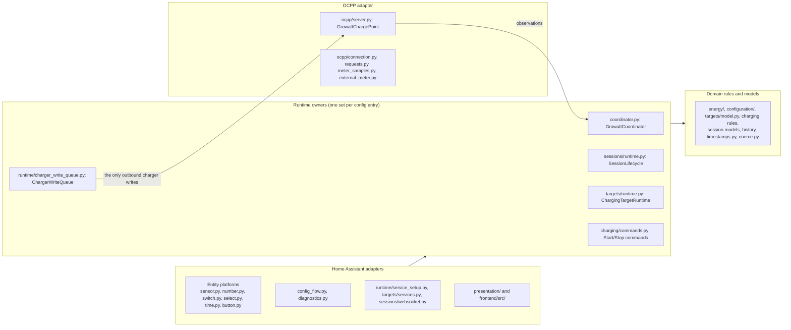
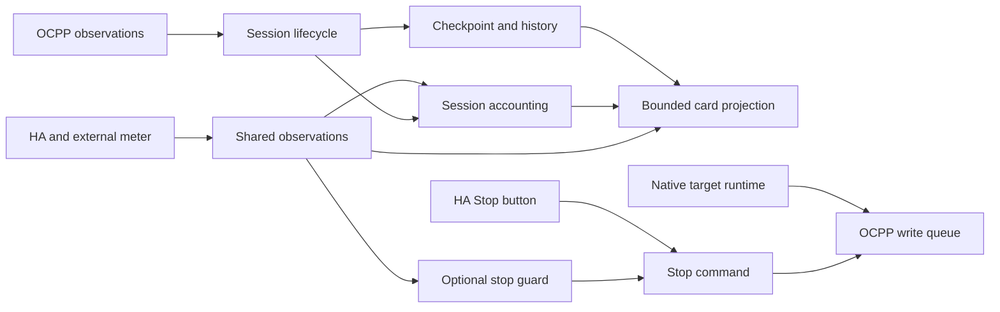

# THOR runtime architecture

[Documentation](../README.md#documentation) · [Start reading the code](CONTRIBUTING.md) · [Runtime flows](runtime-flows.md) · [Invariants](invariants.md) · [Decision records](adr/README.md)

The integration runs one runtime per config entry: a coordinator, a local OCPP
server and a write queue for one charger. The write queue is the only owner of
outbound charger writes for that charger. Statistics live in per-entry storage
(older installations are migrated once); charging targets use their own
per-entry storage keys. Rules that must not change by accident are collected in
the [invariants](invariants.md); the reasons behind them are recorded as
[decision records](adr/README.md).

## Layers at a glance

The code is easiest to read as four layers. Each layer may call the layers to
its right; information from the charger flows back as observations.

- **Home Assistant adapters** translate between HA concepts (entities, services,
  config flows, WebSocket commands, the card) and the runtime owners. They hold no
  charger state of their own beyond a pending user intent.
- **Runtime owners** hold the mutable state of one config entry: the coordinator
  and the objects it composes. They decide when something happens and in which
  order.
- **Domain rules and models** calculate, validate and normalize. Most of these
  modules have no Home Assistant or OCPP dependency and are tested directly.
- **The OCPP adapter** speaks OCPP 1.6 and the Growatt `DataTransfer` extensions.
  Inbound messages become coordinator observations; outbound requests are sent
  only from inside write-queue callbacks.

[`tests/test_layer_boundaries.py`](../tests/test_layer_boundaries.py) checks
this direction statically: platform modules and card projections are imported
only by HA adapters, Home Assistant and the `ocpp` library are imported at runtime
only by an explicit list of modules, the coordinator is imported at runtime only
by entry setup, and the runtime import graph has no cycles.

The [runtime flows](runtime-flows.md) show how a Start, a Stop, a configuration
write and a completed session move through these layers.

## Glossary

| Term | Meaning in this code base |
| --- | --- |
| Config entry | One configured charger in HA. Each entry owns its own coordinator, OCPP server, write queue and storage. |
| Charge point | The connected THOR as seen through one WebSocket (`GrowattChargePoint`). A reconnect creates a new charge point object; only the current one may update the coordinator. |
| Coordinator | `GrowattCoordinator`: per-entry composition root holding observations and delegating to the owners below. Not a proof that the charger applied anything. |
| Observation | A value the charger or a configured HA sensor reported, with its own freshness. Missing or stale observations stay unknown and are never replaced by zero. |
| Charger snapshot | `ChargerSnapshot`: an immutable view derived from the observations of one charger (connection, OCPP status, transaction, latest meter reading). Readers use it instead of combining coordinator attributes. |
| Vehicle state | Derived summary in the style of IEC 61851: `disconnected` (A), `connected` (B), `charging` (C), `fault` (E/F) or `unknown`. The raw OCPP status stays available. |
| Command / intent | A requested change, such as Start or 16 A. It becomes a write-queue item with a policy, an optional dedupe key and a revalidation check. |
| Write queue | `ChargerWriteQueue`: the single owner of outbound charger writes per entry. It orders, spaces, expires, replaces and revalidates commands. |
| Command result | Terminal outcome of one queued command: `confirmed`, `failed`, `skipped`, `expired` or `uncertain`. `uncertain` means the request may have reached the charger and is never replayed automatically. |
| Generation | Version number of a configuration intent. Only the current generation may update the visible pending value or roll it back. |
| Reported / pending value | Reported: the last value the charger returned. Pending: the latest requested value still waiting for its outcome. |
| Readback | A `GetConfiguration` request after writes, coalesced into one task, that reconciles pending values with the charger. |
| Transaction | An OCPP transaction between `StartTransaction` and `StopTransaction`, identified by the integration-allocated transaction ID. |
| Growatt session record | The vendor `DataTransfer` messages `frozenrecord` and `currentrecord` with energy, cost and times of a charging session. |
| Session | The completed charging session shown in history. It combines the OCPP transaction, a matching Growatt record and accounting under one session identity. |
| Correlation | Matching a Growatt record to the completed OCPP transaction it belongs to, using identifiers, times and energy. |
| Pending completion | A stopped transaction snapshot (at most ten) retained until its Growatt record arrives. |
| Outbox / checkpoint | The durable hand-off of completed session rows: HA storage is saved before and after each CSV append, so delivery can be retried after a crash. |
| Native target | An energy, duration or (experimental) budget limit that the wallbox enforces itself. A one-time start can be a wallbox reservation; only the daily repeat schedule is stored and run by HA. |
| Site accounting | Allocation of charged energy to grid, PV and battery sources from site observations, with an explicit booking rule. |
| Stop guard | Optional rule that stops the current transaction through the normal Stop command when battery discharge or grid import persists. It never restarts charging. |
| PV Linkage draft | Local, unsent PV settings in HA. Apply writes them as one compound operation through the queue. |
| Projection | A bounded, read-only view for the card or diagnostics (`presentation/`), derived from observations without changing them. |

## Responsibilities

Python domain packages live below `custom_components/growatt_thor/`. HA platform
entry points (`sensor.py`, `button.py`, `config_flow.py`, etc.), the coordinator
and shared constants stay at the integration root so HA can discover them.

| Package | Responsibility |
| --- | --- |
| `charging/` | Authorization, guarded Start/Stop, current limits and PV controls |
| `targets/` | Native target model, wire adapter, execution, dates and HA services |
| `configuration/` | Configuration values, validation and writes |
| `ocpp/` | Charge point, connection, polling requests, meter samples and diagnostics |
| `runtime/` | Write queue, runtime ownership, service setup and entity migrations |
| `sessions/` | Session lifecycle, identity, events, curves, CSV, outbox and WebSocket reads |
| `energy/` | Shared observations, energy sources, site accounting and automatic Stop |
| `presentation/` | Bounded card projection and frontend resource registration |

The TypeScript source mirrors these feature boundaries in `frontend/src/`:
`charger/`, `targets/`, `authorization/`, `pv/`, `sessions/`, `energy/` and
`shared/`. `index.ts` is the production entry point. Each feature keeps its
component, template, styles and model together; pure calculations stay separate
from Lit lifecycle and HA calls. See
[frontend development](../frontend/README.md#frontend-structure) for the source map.

### Where to find shared building blocks

| Topic | Location |
| --- | --- |
| Session flow thresholds | `sessions/constants.py` |
| Platform configuration keys | `configuration/keys.py` |
| Connection timing and close codes | `ocpp/connection.py` |
| Configuration-write spacing | `const.py` |
| OCPP status groups and normalization | `ocpp/status.py` (accepts both OCPP wire values and translated entity spellings) |
| Enum unwrapping, optional numbers and text | `coerce.py` |
| UTC parsing and installation time zone | `timestamps.py`; display normalization in `sessions/display_times.py` |
| Entity naming and charger/meter device metadata | `entity.py` |
| Simple sensor definitions | `sensor_descriptions.py` (`ThorSensorDescription`: value, availability, attributes, unit, device) |
| Persisted site/battery option keys | `energy/options.py` |
| Site and battery option validation | `energy/site_options.py` |
| Sensor discovery for option forms | `source_discovery.py` |
| Start/Stop rules and charging capabilities | `charging/start_stop_rules.py`, `charging/control_capabilities.py` |
| Derived charger state (connection, status, vehicle state, latest meter reading) | `charging/snapshot.py` (`ChargerSnapshot`) |

### Energy

`energy/allocation.py` separates interval observations, available solar supply
and quality classification from the ordered allocation of EV energy. Its
immutable input record carries only values from one interval; directed
measurements take priority. The package also contains the session accumulator
(`session_accumulator.py`), site inputs (`site_inputs.py`), site observations
(`site_observations.py`) and the stop guard as policy and runtime
(`stop_guard_policy.py`, `stop_guard.py`). Live source allocation for the card is
in `live_allocation.py` and uses the coordinator's public meter-gap policy.
Energy code does not import discovery or presentation.

### Presentation and configuration forms

`presentation/` builds the bounded card data. The battery payload and dashboard
entity map live in `presentation/battery.py` and `presentation/entity_map.py`.
Card projections read explicit protocols from `presentation/contracts.py`.

`config_flow.py::build_site_accounting_schema` assembles the site-accounting form
from policy, power-source and tariff field builders. Saved sections update the
running coordinator through `async_apply_options`; the config-entry data format
stays the same.

## State ownership

The coordinator composes the owners below and keeps public observations,
storage and OCPP meter processing itself. It declares optional state such as
`dashboard_command` and `last_energy_stop` with a `None` default, so "no command
yet" stays distinct from a reported outcome.

| Owner | State it holds |
| --- | --- |
| `runtime/entry.py::EntryRuntime` | Resources of one config entry. Setup publishes the same object on `entry.runtime_data`, the coordinator and the entry-scoped dispatch registry; stable mapping keys are in `runtime/keys.py`. Release clears only the runtime still registered to that entry. |
| `runtime/charger_write_queue.py::ChargerWriteQueue` | Pending `ChargerWriteItem`s, the processor task, monotonic expiry and spacing, completion and shutdown. It talks to the coordinator only through the `WriteQueueOwner` protocol. |
| `sessions/runtime.py::SessionLifecycle` | Session curves, event tracking, restored-session state, pending effective durations, record deduplication, pending completions and the immutable `LastSessionState`. Storage uses its snapshot/restore methods. |
| `ocpp/external_meter_state.py::ExternalMeterState` | External-meter observations, fault matching, poll timeouts, health and PV readiness. |
| `charging/pv_draft.py::PvLinkageDraftState` | The local PV draft, snapshots and initialization from readback. |
| `targets/runtime.py::ChargingTargetRuntime` | Target storage, lock, busy state and schedule timer for one entry. |
| `runtime/polling.py::ExternalMeterPoller` | External-meter polling state. |
| `sessions/outbox.py::SessionOutbox` | Completed rows awaiting CSV delivery. |

Platforms read `entry.runtime_data.coordinator`; connection readers use
`coordinator.charge_point`. Readers that need the charger's state call
`charging/snapshot.py::charger_snapshot`: an immutable `ChargerSnapshot` of
connection, raw and normalized OCPP status, transaction, the latest MeterValues
reading with its sample and receipt times, and a derived IEC 61851-style
`VehicleState`. The status sensor, connection-gated sensors, the card and the
stop guard read it, so they cannot disagree about whether the charger is
connected, faulted or charging. The stop guard builds one snapshot per
evaluation and checks meter freshness against its sample and receipt times.
Retained per-measurand values (energy, phase values, temperature) stay
coordinator attributes. Sensors, diagnostics and guards read the owners directly
(`coordinator.external_meter`, `coordinator.pv_draft`,
`coordinator.sessions.last_session`). Coordinator methods publish updates at the
transition boundaries, so notification order stays explicit.

The coordinator declares `transaction_hooks: TransactionHooks | None`. Session
start/stop observations call this contract; the target runtime implements it,
and unload cancels its timer and clears the hooks.

Narrow protocols in `sessions/contracts.py`, `energy/contracts.py`,
`charging/contracts.py` and `configuration/contracts.py` declare what a module
needs from the coordinator, so domain code does not import it.

Use classes for state with a lifecycle or invariants. Keep transformations,
validation and calculations as typed functions or data models. Package
initializers have no runtime side effects. Domain code must not depend on HA
platform entities or frontend projections to perform charger commands.

## Data flow

Meter processing separates transaction admission, site accounting, effective
duration, live-sample projections and curve recording. Session correlation
separates source matching, energy comparison and source-specific session bounds
from the final diagnostic projection; correlation-only checks do not build
presentation records. The lifecycle keeps deduplication, record timing,
correlation, event merging, last-session updates, accounting and outbox
publication as separate steps. A stop first snapshots the transaction and
telemetry, then reconciles site accounting, then clears live observations and
notifies hooks. PV Apply tracks its progress in one operation object and reports
partial or uncertain outcomes.

Entry setup runs in explicit stages (coordinator, server, background tasks) with
cleanup on failure. `runtime/service_setup.py` registers HA services from a table;
`runtime/services.py` contains the HA-independent single-flight refresh/export
operations. `targets/services.py` registers the target services, also
entry-scoped, with their schemas and response support. `sessions/dashboard.py`
shares the retained-history refresh between its callers.

## Inbound OCPP and diagnostics

Inbound actions share `guarded_ocpp_handler`, which checks socket ownership and
returns each action's fallback reply on failure. Configuration groups are fetched
by one helper; a separate logging helper redacts configuration values and reports
unknown keys. Socket closes share one bounded close helper. Diagnostics are built
by section builders in `diagnostics.py` with redaction at the configuration, OCPP
and session boundaries. The rules for these paths are in the
[invariants](invariants.md#ocpp-handlers-and-logging).

## Charger write queue

Each runtime creates one `ChargerWriteQueue`
([ADR 0001](adr/0001-single-charger-write-owner.md)). Admission validates the
command before `_new_write_item` captures monotonic expiry and creates its
completion handle. `_replace_pending_intent` resolves only unsent entries with the
same dedupe key before the new item is inserted in priority order.

The processor delegates to `_await_connection`, `_await_rate_limit`, `_execute`
and `_classify_failure`. After any wait it returns to queue selection before
removing an item, so replacement and priority apply to waiting work too. Socket
rebinding and the active marker share one exception boundary; cancellation
resolves the active command as uncertain and still propagates to shutdown.

The shared connection-change event wakes both the queue and configuration
readback; the queue's idle event lets readback wait without owning the write
processor. Intent replacement and cancellation touch only pending entries.
Connection-bound commands are rebound to the current socket immediately before
execution, and uncertain commands are never replayed automatically
([ADR 0002](adr/0002-no-automatic-replay-of-uncertain-commands.md)).

Result models, policies and transport exceptions live in
`runtime/write_results.py`. Shutdown semantics are listed in the
[invariants](invariants.md#commands-and-transactions).

## Configuration values and writes

`ConfigurationDefinition` in `configuration/values.py` describes each Growatt key:
entity options, normalized aliases and optional state parsers. Ordered
options/alias mappings are derived from it. The module also declares the live
configuration projections and the parser for paired times. Operational keys are
requested before informational ones.

Configuration entities write through the mixins in `configuration/controls.py`
and `number.py`, always inside write-queue callbacks. Their per-entity rollback
and readback behavior is deliberate and listed in
[configuration write behavior per entity](invariants.md#configuration-write-behavior-per-entity).

## Session history

`sessions/csv.py` writes history rows and enforces retention. `history_store.py`
owns the single reentrant lock, atomic replacements and the recovery journal;
reads, writes, pruning and exports all use that lock. `history_rows.py` owns
stable headers and row normalization, `archive_summary.py` keeps cumulative and
entry-scoped totals, `history_views.py` builds bounded dashboard/detail
projections, and `exports.py` owns CSV export and short-lived downloads.
`runtime/session_history.py` attaches HA events and the 30-second capture interval
to session telemetry.

## Time boundaries

See [ADR 0004](adr/0004-utc-at-presentation-boundary.md) for the reasoning.
`timestamps.py` shares ISO parsing and installation-zone lookup. Explicit parser
options cover the remaining differences between callers: aware-only site
observations, naive duration values, local-calendar CSV filtering and stripped
curve timestamps.

Application timestamps sent to the cards, session-detail WebSocket and CSV
exports are UTC ISO strings with `Z`. The frontend formats list dates, chart
axes, events and target notices in `hass.config.time_zone`; target input uses
that same installation zone regardless of the browser's zone. The timestamp
sensors for the last session also expose UTC strings.

Growatt wire values, raw diagnostics and stored source CSV times stay as
reported. UTC presentation is computed after session identity/correlation, so
CSV rows, deduplication keys and session IDs are not rewritten. Naive local times
are interpreted in HA's configured installation zone. A missing or ambiguous
instant is shown as unknown; spring gaps and autumn folds never get a guessed
offset. Export date filters use installation-local calendar days.

Absolute one-time starts carry explicit offsets. Daily schedules keep their
requested local clock plus zone, including the DST recurrence policy; Growatt
reservation requests are encoded in device-local time at the wire boundary. The
target dialog rejects nonexistent/ambiguous input times. Services can represent
an autumn occurrence explicitly using an ISO timestamp with its offset. Session
durations use resolved elapsed UTC instants.

## Persistent completion

See [ADR 0006](adr/0006-checkpointed-session-outbox.md) for the reasoning.
The coordinator checkpoint includes totals, the last 50 applied record identities,
active-session state, accounting state and completed rows awaiting delivery.
Up to ten completed OCPP snapshots retain identifiers, bounded events/curves and
accounting while waiting for their Growatt records; matching delivery removes
them from the pending checkpoint.
The outbox saves this checkpoint before writing CSV, then saves again after
acknowledgement. A failed append keeps its row available for the next flush;
setup, later completions and shutdown retry delivery.

History operations are serialized across executor jobs. A temporary journal
contains the resulting rows and archive summary; recovery writes that result
again rather than reapplying additions. Explicit session IDs deduplicate replay;
a bounded set of 1,000 recent delivery identities also survives detail pruning.
This protects recent completion retries, not arbitrary replay of an unlimited
old stream. Rows without an explicit identity keep their original migration
semantics. Backups must include HA storage, CSV, summary and any pending journal
together.

## Typing

TypeScript runs in strict mode. Known HA attributes have explicit types;
unrelated attributes are `unknown`, and entity lookups can be absent. In the
frontend, `SessionDetailStore` owns historical-detail requests and a bounded
cache: it deduplicates concurrent loads, waits for an explicit retry after errors
and invalidates pending replies when the configured entry changes or the card
disconnects. Live/inline curves bypass historical detail.

Python is checked with mypy in strict mode for the scope listed in
`pyproject.toml`: coercion and time helpers, configuration, energy, charging,
runtime, OCPP, target models and builders, all session modules, the coordinator
and all six HA platforms. Integration setup, config flows, target execution,
diagnostics and the remaining presentation helpers are not in this scope yet.
Persisted target dictionaries remain a validated serialization boundary rather
than a typed state machine.

- Compile-only checks in `tests/typing/owner_contracts.py` verify that the
  concrete coordinator satisfies the owner protocols. A minimal HA coordinator
  stub keeps an unresolved framework base from hiding missing attributes; the
  typed base is selected only for static checking.
- HA platform stubs describe entity properties and the coordinator generic, so
  the adapters are checked without importing HA at development time. Local
  library stubs describe the `ocpp` subclass, routing and payload boundaries;
  OCPP schema validation still owns wire validation.
- Number acceptance and working-mode acceptance use separate hooks with required
  domain values; the shared transport helper keeps the raw acknowledgement.
- Charging commands declare transaction transport, completion callback and PV
  service capabilities. RFID validation narrows identifiers only after validation
  succeeds.
- Queue clock/task host, completion callbacks and refresh transports are typed;
  task factories preserve result types, and framework error helpers are declared
  as always raising.
- Restored opaque transaction identifiers stay valid observations next to integer
  OCPP IDs; typing does not coerce them.

## Validation

Python regression tests cover queues, ownership, targets, upgrades, source
allocation, session recovery, interrupted retention, replay and Stop execution
without entities. Contract fixtures in `tests/fixtures/` pin entity values,
configuration writes, session storage, diagnostics and OCPP fallbacks; see
[`tests/fixtures/README.md`](../tests/fixtures/README.md). Frontend checks cover
formatting, types, view-model behavior and all integration locales. Generated
assets are committed and must rebuild without a diff. CI runs both suites.

The preview uses simulated data and never contacts a charger. Unit tests and
preview checks do not replace testing on HA or real hardware. Target capture
evidence is limited to the firmware named in the reverse-engineering notes;
budget enforcement remains experimental.

## Safety and compatibility invariants

Moved to [invariants](invariants.md).

## Configuration write compatibility

Moved to [configuration write behavior per entity](invariants.md#configuration-write-behavior-per-entity).
