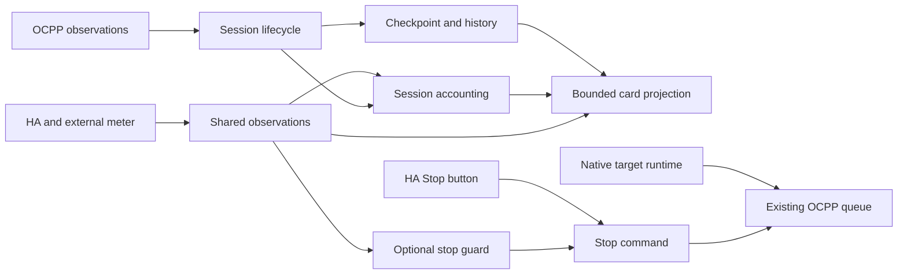

# THOR runtime architecture

[Documentation](../README.md#documentation) · [Start reading the code](CONTRIBUTING.md)

The integration owns one runtime and coordinator per config entry. Existing HA
entity identities, service names and configuration keys remain stable. Statistics
move to per-entry storage with a one-time legacy migration; charging-target
storage keeps its existing per-entry keys. The OCPP queue remains the only owner
of outbound charger writes for each charger.

## Responsibilities

Python domain packages live below `custom_components/growatt_thor/`. HA platform
entrypoints (`sensor.py`, `button.py`, `config_flow.py`, etc.), the coordinator and
shared constants remain at the integration root so HA can discover them.

| Package | Responsibility |
| --- | --- |
| `charging/` | Authorization, guarded Start/Stop, current limits and PV controls |
| `targets/` | Native target model, wire adapter, execution, dates and HA services |
| `configuration/` | Configuration values, validation and writes |
| `ocpp/` | Charge point, connection, polling requests, meter samples and diagnostics |
| `runtime/` | Write queue, runtime ownership, service setup and entity migrations |
| `sessions/` | Session lifecycle, identity, events, curves, CSV, outbox and WebSocket reads |
| `energy/` | Shared observations, energy sources, site accounting and automatic Stop |
| `presentation/` | Bounded card projection and frontend resource registration |

The TypeScript source mirrors feature boundaries in `frontend/src/`: `charger/`,
`targets/`, `authorization/`, `pv/`, `sessions/`, `energy/` and `shared/`.
`index.ts` is the production entrypoint. Each feature keeps its component,
template, styles and model together; pure calculations remain separate from
Lit lifecycle and HA calls. See [frontend development](../frontend/README.md#frontend-structure) for the source map.

Session flow thresholds live in `sessions/constants.py`; platform configuration keys live in `configuration/keys.py`. Connection timing and close codes remain in `ocpp/connection.py`, while shared configuration-write spacing is defined in `const.py`. These constants preserve the existing values and wire spelling.

`ocpp/status.py` owns canonical status groups and normalizes both OCPP wire values and translated entity spellings before transaction and telemetry checks. `coerce.py` contains shared enum unwrapping.

`entity.py` owns shared entity naming and charger/meter device metadata. Platform entities retain their existing unique-ID expressions and defer HA attachment to the entity lifecycle; write guards read the coordinator's shared control-policy method.

Generic UTC helpers live in `timestamps.py`; session display normalization lives in `sessions/display_times.py`. Energy code separates allocation mathematics (`allocation.py`), the session accumulator (`session_accumulator.py`), site inputs (`site_inputs.py`), observations (`site_observations.py`) and stop policy/runtime (`stop_guard_policy.py` / `stop_guard.py`). Charging capabilities and Start/Stop rules live in `charging/control_capabilities.py` and `charging/start_stop_rules.py`. Old module paths retain thin compatibility exports. Persisted site/battery option keys are declared in `energy/options.py`.

## State and typing

`ChargingTargetRuntime` owns one entry's target storage, lock, busy state and
schedule timer. Its bound methods implement the unchanged target service
contract; unload cancels the timer and releases transaction callbacks.
`SessionOutbox` owns delivery state with typed persistence callbacks and validates
session identities before accepting rows. `ChargingMeterObservation` declares
the normalized telemetry shape while malformed or missing packets stay unknown.

In the frontend, `SessionDetailStore` owns historical-detail requests and a
bounded cache. It deduplicates concurrent loads, waits for an explicit retry
after errors and invalidates pending replies when the configured entry changes
or the card disconnects. Live/inline curves bypass historical detail. Known HA
attributes have explicit types; unrelated attributes are `unknown`, and entity
lookups can be absent. The TypeScript compiler checks these boundaries in strict
mode. Python typing is incremental; persisted target dictionaries remain a
validated serialization boundary rather than a fully typed state machine.

Use classes for state with a lifecycle or invariants. Keep transformations,
validation and calculations as typed functions or data models. Package initializers
stay free of runtime side effects. Domain code must not depend on HA platform
entities or frontend projections to perform charger commands.

The coordinator retains public observations, storage and OCPP meter processing.
`ChargerWriteQueue` owns pending typed `ChargerWriteItem` entries, the processor
task, monotonic expiry/spacing, completion and shutdown. The coordinator delegates
its existing queue/cancel/pending API to that owner. A narrow owner protocol
supplies connection observations, polling pauses, configuration readback and
result publication; the queue does not import the coordinator. Session transitions are delegated to `SessionLifecycle`; this is
an incremental boundary, not a replacement of the established runtime owner.

## Safety and compatibility invariants

- An accepted command does not prove a transaction started, stopped or moved
  energy. Queue status, charger observations and energy flow remain distinct.
- Stop cancels an unsent Start before considering a physical Stop. A Stop is
  tied to the observed transaction; a later transaction invalidates it.
- The automatic guard reads shared observations and calls the Stop command.
  It imports neither dashboard projection nor accounting runtime and never
  requires a registered button. It cannot automatically restart charging.
- Target services retain their public names and charging-target storage key.
  Wallbox-native energy/time limits and HA-owned repeat scheduling stay separate.
- Unit/sign normalization is shared. Automatic controls require recent source
  reports; display and accounting accept available, unchanged HA sensor states.
  THOR meter freshness is checked in both cases. Missing and unavailable values
  are not zero.
- The view contract is bounded: at most 20 recent rows, 24 events and 96 curve
  points per session, with a 12 KiB target. Historical detail is loaded on demand.
  Pagination covers those recent rows, not the full archive.

## Charger write queue

Each runtime creates one `runtime/charger_write_queue.py::ChargerWriteQueue`.
The shared connection-change event wakes both the queue and configuration
readback; the queue's idle event lets readback wait without owning the write
processor. Intent replacement and cancellation touch only pending entries.
Connection-bound commands are rebound to the current socket immediately before
execution, and uncertain commands are never automatically replayed.

Shutdown first closes queue admission and cancels active work, then resolves
pending entries as unsent. Active work stays uncertain because it may already
have reached OCPP. Every handle gets one terminal result, including late work
during unload. Result models, policies and transport exceptions live in
`runtime/write_results.py`; `runtime/write_queue.py` remains a compatibility shim.

## Time boundaries

`timestamps.py` shares ISO parsing and installation-zone lookup. Explicit parser options preserve legacy differences: aware-only site observations, naive duration values, local-calendar CSV filtering and stripped curve timestamps. `coerce.py` provides optional number/text conversion; wrappers retain each boundary's finiteness, sign, size and error rules.

Application timestamps sent to the cards, session-detail WebSocket and CSV
exports are UTC ISO strings with `Z`. The frontend formats list dates, chart
axes, events and target notices in `hass.config.time_zone`; target input uses
that same installation zone regardless of the browser's zone. The timestamp
sensors for the last session also expose UTC strings.

Growatt wire values, raw diagnostics and retained source CSV times remain as
reported. UTC presentation is computed after session identity/correlation, so
existing CSV rows, deduplication keys and session IDs are not rewritten. Existing
naive local times are interpreted in HA's configured installation zone. A missing
or ambiguous instant is shown as unknown; spring gaps and autumn folds never get
a guessed offset. Export date filters still use installation-local calendar days.

Absolute one-time starts carry explicit offsets. Daily schedules keep their
requested local clock plus zone, including the existing DST recurrence policy;
Growatt reservation requests are encoded in device-local time at the wire
boundary. The target dialog rejects nonexistent/ambiguous input times. Services
can represent an autumn occurrence explicitly using an ISO timestamp with its
offset. Newly completed session durations use resolved elapsed UTC instants.

## Persistent completion

The coordinator checkpoint includes totals, the last 50 applied record identities,
active-session state, accounting state and completed rows awaiting delivery.
Up to ten completed OCPP snapshots retain identifiers, bounded events/curves and
accounting while waiting for their Growatt records; matching delivery removes
them from the pending checkpoint.
The outbox saves this checkpoint before writing CSV, then saves again after
acknowledgement. A failed append keeps its row available for the next flush;
setup, later completions and shutdown retry delivery.

History operations are serialized across executor jobs. A temporary journal
contains the resulting rows and archive summary; recovery writes that result
again rather than reapplying additions. Explicit session IDs deduplicate replay;
a bounded set of 1,000 recent delivery identities also survives detail pruning.
This protects recent completion retries, not arbitrary replay of an unlimited
old stream. Legacy rows without an explicit identity keep their original
migration semantics. Backups must include HA storage, CSV, summary and any
pending journal together.

## Validation

Python regression tests cover queues, ownership, targets, upgrades, source
allocation, session recovery, interrupted retention, replay and Stop execution
without entities. Frontend checks cover formatting, types, view-model behavior
and all integration locales. Generated assets are committed and must rebuild
without a diff. CI runs both suites.

The preview uses simulated data and never contacts a charger. Unit tests and
preview checks do not replace testing on HA or real hardware. Existing target
capture evidence remains limited to the firmware named in the reverse-engineering
notes; budget enforcement remains experimental.
