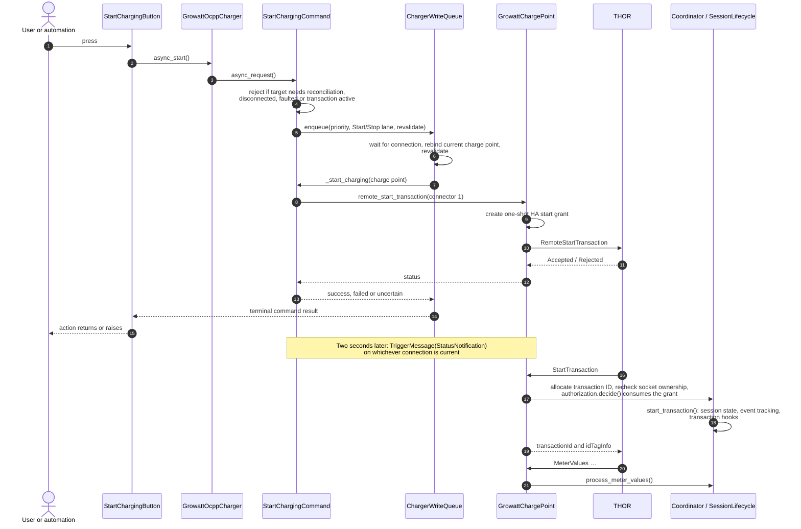
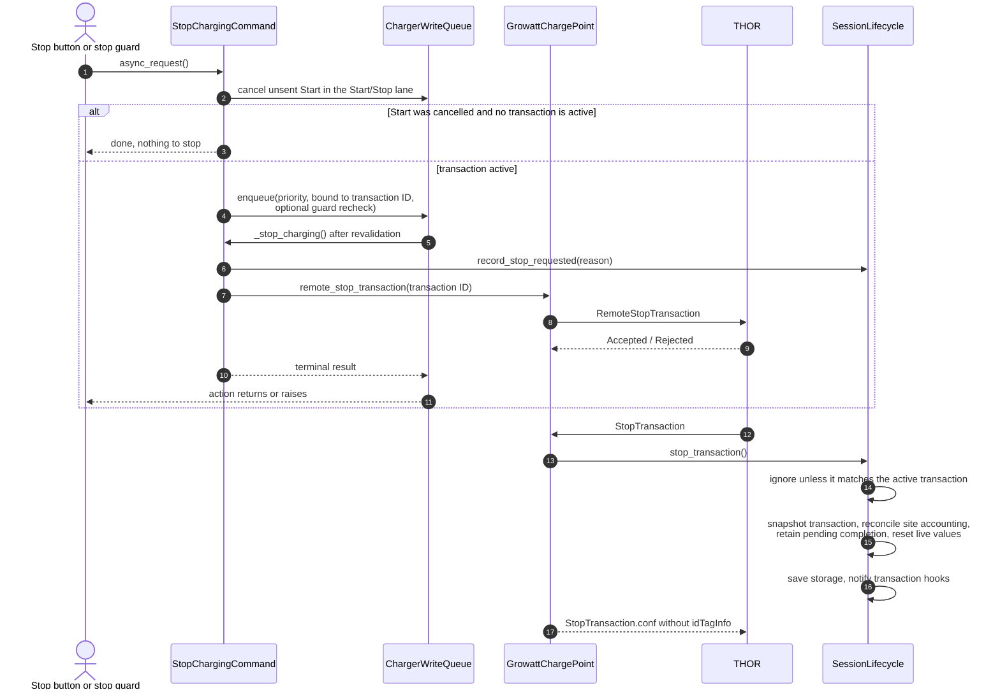
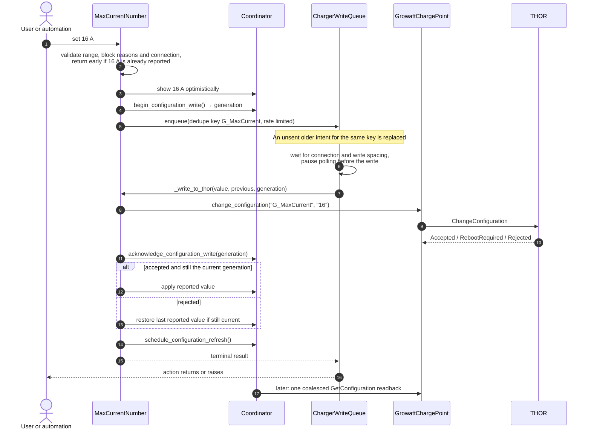
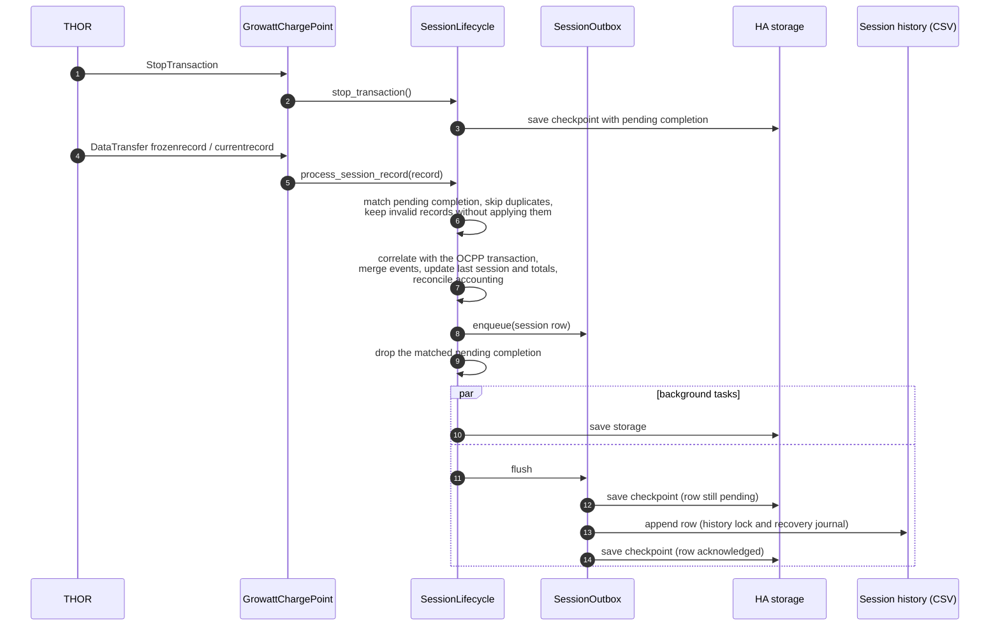

# Runtime flows

[Documentation](../README.md#documentation) · [Architecture](architecture.md) · [Start reading the code](CONTRIBUTING.md)

These diagrams follow four common paths through the code. They show who owns each
step and where a Home Assistant action finishes. Terms are explained in the
[glossary](architecture.md#glossary); timeout, replacement and reconnect rules are
described in [automation resilience](automation-resilience.md).

Three distinctions run through all of them:

- **Queued, sent and confirmed are different states.** An HA action that waits
  for a command finishes with the queue's terminal result, not with a later
  charger observation.
- **Only the write queue sends charger writes.** Entities, services, targets and
  the stop guard enqueue work; the queue rebinds the current charge point and
  revalidates the intent immediately before sending.
- **Observations arrive separately.** `StartTransaction`, `StopTransaction`,
  `StatusNotification`, `MeterValues` and Growatt records update the coordinator
  whenever the charger sends them, independent of any command.

## Start charging

Code: [`charging/growatt_charger.py`](../custom_components/growatt_thor/charging/growatt_charger.py),
[`charging/commands.py`](../custom_components/growatt_thor/charging/commands.py),
[`runtime/charger_write_queue.py`](../custom_components/growatt_thor/runtime/charger_write_queue.py),
[`ocpp/server.py`](../custom_components/growatt_thor/ocpp/server.py),
[`sessions/runtime.py`](../custom_components/growatt_thor/sessions/runtime.py).

A rejected or failed request revokes the one-shot grant. An uncertain request
keeps it for its short lifetime, because the charger may still send the
matching `StartTransaction`.

## Stop charging

Code: [`charging/commands.py`](../custom_components/growatt_thor/charging/commands.py),
[`energy/stop_guard.py`](../custom_components/growatt_thor/energy/stop_guard.py),
[`sessions/runtime.py`](../custom_components/growatt_thor/sessions/runtime.py).

A Stop is tied to the transaction it was created for. If a different
transaction is active when the queue reaches it, the command is skipped. The
stop guard adds its own recheck so a condition that cleared while waiting does
not stop charging.

## Write a configuration value

The example is the maximum current. Other configuration entities differ in
their rollback and readback details; see
[configuration write behavior per entity](invariants.md#configuration-write-behavior-per-entity).

Code: [`number.py`](../custom_components/growatt_thor/number.py),
[`configuration/controls.py`](../custom_components/growatt_thor/configuration/controls.py),
[`coordinator.py`](../custom_components/growatt_thor/coordinator.py).

For the number entities, an uncertain write marks the generation as uncertain and
requests the readback immediately instead of guessing the charger's value.

## Complete a session

Code: [`sessions/runtime.py`](../custom_components/growatt_thor/sessions/runtime.py),
[`sessions/outbox.py`](../custom_components/growatt_thor/sessions/outbox.py),
[`sessions/csv.py`](../custom_components/growatt_thor/sessions/csv.py),
[`sessions/history_store.py`](../custom_components/growatt_thor/sessions/history_store.py).

If the CSV append fails, the row stays in the checkpoint and is retried on
setup, after later completions and at shutdown. Session IDs make a repeated
append harmless. See [persistent completion](architecture.md#persistent-completion)
for limits and backup advice.
